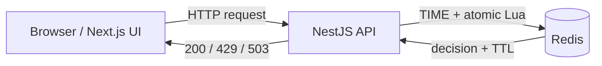

# Kiến trúc MVP

Next.js chịu trách nhiệm trình bày. NestJS validate payload, kiểm tra quota bảo vệ dịch vụ và quyết định HTTP status. Redis giữ metadata phiên và state thuật toán; không có database quan hệ trong MVP.

## Session

Token 256-bit ngẫu nhiên từ server, dạng 64 ký tự hex; token là bearer capability của phiên demo, không phải authentication người dùng. Metadata có TTL 900 giây. Client không truyền Redis key hoặc thời gian. Prefix `portfolio:{token}:...` giữ metadata và state trên cùng hash slot.

Mỗi phiên có hai quota độc lập: `fixed` và `sliding`. Reset xóa metadata và cả hai key bằng một lệnh DEL; request đến sau reset nhận 410. Config chỉ được chọn khi tạo phiên; thay đổi config tạo phiên mới.

## Fixed Window

`bucket = floor(redisTimeMs / windowMs)`. Một hash giữ bucket và accepted count. Khi đổi bucket, count bắt đầu từ 0. TTL kết thúc ở `(bucket + 1) * windowMs`. Request vượt limit không tăng count. O(1) state; có thể nhận hai burst gần nhau ở hai phía boundary.

## Sliding Window Log

Sorted set lưu timestamp của request được nhận, member là ID ngẫu nhiên riêng của mỗi request. Loại bỏ các timestamp `<= now - window`; check ZCARD; nếu còn quota thì ZADD và PEXPIRE. Khi full, Retry-After dựa vào request cũ nhất. Check/update chạy trong một Lua script, tránh race condition.

`resetAt` là mốc sớm nhất quota có thể hồi phục, không phải lúc toàn bộ sorted set rỗng. `retryAfterMs` bằng 0 khi được nhận và thời gian cần đợi khi bị chặn.

## Failures

Redis connection timeout 1.5 giây, command timeout 2 giây; không xếp hàng request vô hạn khi offline. API trả 503 khi dependency lỗi, không thay Redis bằng memory. Liveness kiểm tra process; readiness cần PING Redis.

Frontend retry GET readiness bằng backoff trong tối đa 90 giây; POST không retry tự động. Network error khi gửi POST có thể xảy ra sau khi backend đã nhận request, nên UI không tự replay. Dừng burst không hoàn tác request đã đến server. Lịch sử tối đa 200, chart hiển thị 40 request gần nhất.

## Kiểm thử

Integration tests chạy trên Redis thật: concurrency, TTL, session isolation, reset và dependency outage. Boundary tests thay đồng hồ **chỉ trong bản sao script tại test**, production luôn gọi Redis TIME và không có clock override endpoint.

Tham khảo: [Redis rate limiter](https://redis.io/docs/latest/develop/use-cases/rate-limiter/).
