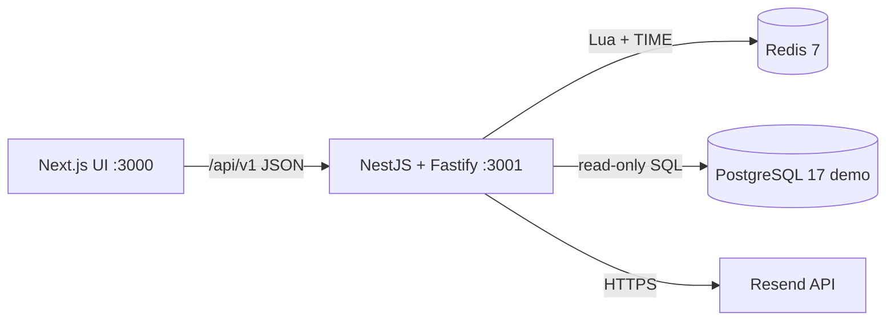

# Kiến trúc hệ thống

Next.js đóng vai trò trình diễn giao diện, hiển thị biểu đồ và gọi API thông qua contract dùng chung. NestJS (chạy trên Fastify) chịu trách nhiệm validate payload bằng strict parser, kiểm tra quota bảo vệ chống lạm dụng và điều phối xử lý với các dịch vụ phụ thuộc.

## Session

- Token 256-bit ngẫu nhiên từ server (64 ký tự hex); token là bearer capability tạm thời của phiên demo, không phải thông tin định danh người dùng.
- Metadata có TTL 900 giây (15 phút).
- Prefix `portfolio:{token}:...` đảm bảo metadata và state của cả hai thuật toán nằm cùng Redis hash slot.
- Mỗi phiên có hai quota độc lập: `fixed` và `sliding`. Lệnh Reset xóa metadata và cả hai key bằng một lệnh `DEL`; request đến sau khi reset sẽ nhận `410 Gone`.

## Thuật toán Rate Limiting

### Fixed Window

- `bucket = floor(redisTimeMs / windowMs)`.
- Một Redis hash lưu giữ bucket ID và accepted count. Khi đổi sang bucket mới, count reset về 0.
- TTL của key kết thúc tại mốc `(bucket + 1) * windowMs`. Request bị từ chối không tăng bộ đếm count. Trạng thái O(1) bộ nhớ; có thể gặp hiện tượng burst gấp đôi quota tại ranh giới hai bucket liên tiếp.

### Sliding Window Log

- Sorted set lưu timestamp (mili-giây) của các request được chấp nhận, member là UUID ngẫu nhiên duy nhất cho mỗi request.
- Thuật toán loại bỏ các timestamp cũ hơn `now - windowMs` bằng `ZREMRANGEBYSCORE`, đếm số lượng qua `ZCARD`. Nếu còn quota thì `ZADD` và cập nhật `PEXPIRE`.
- Nếu hết quota, `Retry-After` được tính dựa trên độ tuổi của request cũ nhất trong cửa sổ. Toàn bộ logic diễn ra trong một Redis Lua script nguyên tử để triệt tiêu race condition.
- `resetAt` là thời điểm sớm nhất một lượt quota sẽ hồi phục, không phải lúc toàn bộ sorted set rỗng.

## SQL Sandbox Boundary

- Database PostgreSQL độc lập chỉ chứa bảng `demo.users` với các bản ghi giả lập.
- Kết nối thông qua role `portfolio_demo_reader` bị tước quyền ghi (`SELECT` only), `default_transaction_read_only = on`.
- Khi thực thi query, API mở transaction rõ ràng `BEGIN READ ONLY` và áp dụng `SET LOCAL statement_timeout = 250`.
- Connection pool cực nhỏ (`max: 2`), ngắt kết nối nhanh khi có dấu hiệu quá tải.
- Bộ lọc đầu vào loại bỏ ký tự ngoài tập printable ASCII và cấm tuyệt đối dấu chấm phẩy `;`.
- Lỗi từ Postgres được chuẩn hóa thành mã lỗi HTTP chung chung; không lộ cấu trúc bảng hay thông báo lỗi SQL ra ngoài.

## Contact Boundary

- Chỉ nhận JSON có cấu trúc định sẵn (`name`, `email`, `message`, `website`).
- Field `website` là honeypot ẩn trên giao diện; nếu có giá trị (do bot điền tự động), API trả về `202 accepted` nhưng không chuyển tiếp tới email provider.
- Người nhận email luôn cố định ở server (`CONTACT_TO_EMAIL`); payload từ client không có quyền chỉ định địa chỉ nhận.
- Nội dung email định dạng plain-text thuần túy; email của khách được gán vào header `Reply-To`.
- Lỗi kết nối tới Resend được bọc thành lỗi `503 Service Unavailable` chung chung, không trả về chi tiết từ nhà cung cấp.

## Xử lý sự cố (Failure Handling)

- **Redis**: Connection timeout 1.5 giây, command timeout 2 giây; tắt chế độ xếp hàng offline vô hạn. Khi Redis mất kết nối, API trả về `503`, `/api/v1/health/ready` trả về `503`. Không có fallback lưu tạm vào RAM.
- **Postgres**: Lỗi kết nối database chỉ làm endpoint `/playground/sql-injection/query` trả về `503`. Trạng thái `/health/ready` của dịch vụ chỉ phụ thuộc vào Redis.
- **Resend**: Lỗi kết nối hoặc lỗi xác thực từ Resend trả về `503` cho endpoint `/contact`.
- **Cold start UX**: Frontend chờ backend và thăm dò `/api/v1/health/ready` với exponential backoff tối đa 90 giây; **tuyệt đối không tự động retry request POST**.

## Trade-offs và Quyết định Thiết kế

| Thành phần             | Lợi thế                                                                                    | Hạn chế / Đánh đổi                                                                                                |
| ---------------------- | ------------------------------------------------------------------------------------------ | ----------------------------------------------------------------------------------------------------------------- |
| **Fixed Window**       | O(1) memory, thực thi cực nhanh trên Redis hash.                                           | Có thể chịu burst gấp đôi quota tại ranh giới chuyển giao 2 window.                                               |
| **Sliding Window Log** | Cửa sổ mượt mà, tính toán chính xác 100% theo thời gian thực.                              | Tốn O(limit) bộ nhớ cho sorted set; chi phí CPU cao hơn khi cleanup log.                                          |
| **Redis TIME**         | Đồng bộ thời gian nguyên tử giữa mọi API replica; không phụ thuộc clock máy chủ.           | Mọi thao tác kiểm tra rate limit đều phải round-trip tới Redis.                                                   |
| **SQL Unsafe Mode**    | Cho phép người dùng quan sát trực quan sự khác biệt giữa nối chuỗi và parameterized query. | Là một attack surface có chủ đích, đòi hỏi nhiều tầng cô lập nghiêm ngặt (role, read-only, timeout, input bound). |
| **No Memory Fallback** | Đảm bảo tính trung thực tuyệt đối của demo phân tán; không giấu lỗi khi hạ tầng gặp sự cố. | API từ chối phục vụ ngay lập tức khi Redis gặp trục trặc.                                                         |
